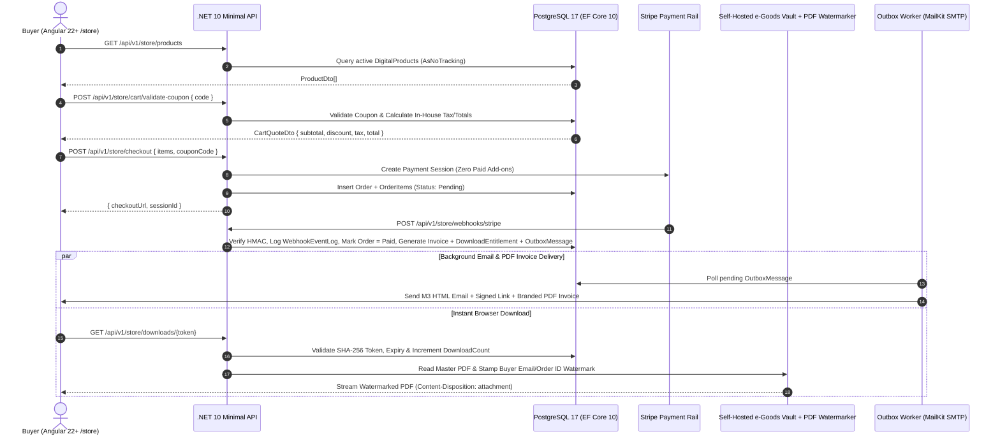

# Migration & Architecture Plan: Angular 22+ Frontend & Storybook (Part 1) + 100% Self-Owned .NET 10 Minimal API, OpenAPI & e-Goods Store (Part 2)

> [!IMPORTANT]
> **Execution Strategy & Monorepo Modular-Monolith Architecture**:
>
> - **Monorepo Layout**: The repository is structured as a **Monorepo Modular-Monolith** with two primary top-level application directories at `$root` (alongside root documentation `README.md`, `plan.md`, `design.md`, `AGENTS.md`, `Makefile`, and `compose.yaml`):
>   - **`$root/web/`**: The **Angular 22+ (Zoneless, Signals-first, Standalone)** frontend workspace, Storybook (`@storybook/angular`), Shared UI Component Library (`@ui`), and single global stylesheet (`web/src/styles/styles.scss`).
>   - **`$root/api/`**: The **100% Self-Owned .NET 10 Modular Monolith** (`PersonalSite.slnx` / `PersonalSite.sln`) organized by domain modules (`Resume`, `Poems`, `Books`, `Store`, `Identity/Admin`) over **Entity Framework Core 10 + PostgreSQL**.
> - **Part 1 (First Priority — `$root/web/`)**: Port the existing Vue 3 + Vuetify 3 frontend into `$root/web/` using **Modern Angular 22+**, a **Shared UI Component Library (`@ui`)** wrapping Angular Material (M3) components, a **single [`web/src/styles/styles.scss`](web/src/styles/styles.scss) file**, the **Store Tab (`/store`) UI**, and **Storybook (`@storybook/angular`)** per [`design.md`](design.md).
> - **Part 2 (Second Priority — `$root/api/`)**: Build the **100% Self-Owned Modern .NET 10 Modular-Monolith Minimal API + Entity Framework Core 10 + PostgreSQL** backend in `$root/api/`—including our hand-rolled **Shopping Cart & Coupon Engine**, **In-House Tax & PDF Invoice Generator**, **Direct Stripe Payment Processing (zero SaaS add-on fees)**, **PostgreSQL Outbox + SMTP/MailKit Email Fulfillment Worker**, **On-the-Fly Buyer PDF Watermarking & Self-Hosted Storage Vault**, **Store Admin Catalog API**, **OpenAPI 3.1** codegen (`openapi/v1.json` consumed by `web/`), and root **Prettier + ESLint + Husky** pre-commit hooks.

---

## 0. Monorepo Modular-Monolith Directory Structure (`$root/web/` + `$root/api/`)

Why **`web/` + `api/`** (lowercase, concise, industry-standard):

- Avoids case-sensitivity pitfalls across macOS, Linux containers, and Git (`web/` and `api/` match standard Docker/K8s service names and CLI conventions).
- Clearly separates the SPA/SSR web client (`web/`) from the `.NET 10` modular-monolith backend (`api/`), while keeping shared orchestration (`Makefile`, `compose.yaml`, `.husky/`, `AGENTS.md`, `plan.md`, `design.md`) at `$root`.

```text
$root/
├── web/                                    # Angular 22+ Frontend & Storybook Workspace
│   ├── .storybook/                         # Storybook (@storybook/angular) configuration
│   ├── Dockerfile                          # Multi-stage Docker build (dev watch target + nginx/Caddy prod target)
│   ├── .dockerignore
│   ├── public/                             # Static public assets
│   ├── src/
│   │   ├── app/
│   │   │   ├── core/                       # Singleton @Service() providers, layout, OpenAPI client
│   │   │   ├── shared/ui/                  # @ui Material M3 wrapper component library + *.stories.ts
│   │   │   └── features/                   # Lazy-loaded feature routes (resume, store, poems, books, about)
│   │   ├── assets/                         # Static JSON, PDFs, images (NgOptimizedImage)
│   │   ├── environments/                   # Angular environment configs
│   │   └── styles/
│   │       └── styles.scss                 # SINGLE global stylesheet (all 7 M3 layers)
│   ├── angular.json
│   ├── package.json
│   └── tsconfig*.json
├── api/                                    # .NET 10 Modular-Monolith Backend
│   ├── Dockerfile                          # Multi-stage .NET 10 SDK/Runtime Dockerfile (dev hot-reload + prod chiseled)
│   ├── .dockerignore
│   ├── PersonalSite.sln                    # Solution file at $root/api/
│   ├── Directory.Build.props               # Shared .NET 10 strict compiler & analyzer settings
│   ├── openapi/
│   │   └── v1.json                         # Build-time generated OpenAPI 3.1 contract
│   ├── src/
│   │   ├── PersonalSite.Api/               # Host, Minimal API bootstrap, Scalar, OpenAPI, Middleware
│   │   └── Modules/                        # Modular-Monolith vertical slices (or namespaces/assemblies)
│   │       ├── Portfolio/                  # Resume (Experience, Skills), Poems, Books endpoints & EF configs
│   │       ├── Store/                      # e-Goods Catalog, Cart, Coupons, Tax, Invoices, Stripe, Vault
│   │       └── Fulfillment/                # Transactional Outbox, MailKit SMTP Worker, PDF Watermarker
│   └── tests/
│       └── PersonalSite.Api.Tests/         # xUnit / WebApplicationFactory integration tests
├── .agents/rules/                          # Antigravity workspace rules (always_on)
│   ├── angular-best-practices.md           # Angular 22+, TypeScript 6+, @ui & single styles.scss rules
│   ├── dot-net-best-practices.md           # .NET 10, C# 14, Modular-Monolith Minimal API & OpenAPI rules
│   └── postgres-best-practices.md          # PostgreSQL 17, EF Core 10, Npgsql, indexing & outbox rules
├── AGENTS.md                               # Root coding & architectural rules index
├── README.md
├── design.md
├── plan.md
├── compose.yaml                            # Full-stack Docker Compose (web, api, postgres:17-alpine, mailpit)
└── Makefile                                # Unified commands for both Native Local & Docker execution
```

### 0.1 Dual-Mode Execution: Native Local OR Docker (`compose.yaml` + `Makefile`)

Every service in the monorepo (`web/`, `api/`, `db` (`postgres:17-alpine`), `mailpit`) is **Docker-enabled** with multi-stage `Dockerfile`s (`web/Dockerfile` and `api/Dockerfile`) and `$root/compose.yaml`, paired with symmetrical `make <service>` (native) vs `make docker-<service>` (containerized) targets in `$root/Makefile`:

| Target / Scenario             | Native Local Command | Docker Counterpart Command | Description                                                                                                                                                    |
| :---------------------------- | :------------------- | :------------------------- | :------------------------------------------------------------------------------------------------------------------------------------------------------------- |
| **Frontend (`web/`)**         | `make web`           | `make docker-web`          | Runs the Angular 22+ app on port `4200` natively (`npm --prefix web start`) or inside its Docker container (`docker compose up --build web`).                  |
| **Backend (`api/`)**          | `make api`           | `make docker-api`          | Runs the `.NET 10` Modular Monolith on port `5000`/`8080` + Scalar UI (`/scalar/v1`) natively (`dotnet watch`) or in Docker (`docker compose up --build api`). |
| **Database (`db`)**           | `make db`            | `make docker-db`           | Starts PostgreSQL 17 (natively via local `pg_ctl`/service or in Docker via `docker compose up -d db mailpit`).                                                 |
| **Full Stack (All)**          | `make dev`           | `make docker-up`           | Boots the entire stack (`db` + `api` + `web`).                                                                                                                 |
| **Stop Containers**           | —                    | `make docker-down`         | Gracefully stops running Docker Compose containers without deleting data volumes.                                                                              |
| **Nuke DB Volume Only**       | —                    | `make docker-db-nuke`      | Stops the `db` container, destroys **only** the PostgreSQL volume (`postgres_data`), and restarts a clean `db` ready for fresh migrations & seeding.           |
| **Nuke All Docker State**     | —                    | `make docker-nuke`         | Tears down **all** project containers, networks, named volumes, local images, and orphan containers (`docker compose down -v --rmi local --remove-orphans`).   |
| **Regenerate OpenAPI Client** | `make openapi-regen` | —                          | Builds the `.NET 10` OpenAPI 3.1 spec (`api/openapi/v1.json`) and regenerates the Angular TypeScript client (`@hey-api/openapi-ts`) in `web/`.                 |

---

## 1. Size & Effort Estimation: Porting to Angular 22+ & Storybook (Part 1)

### 1.1 Existing Codebase Baseline (Measured)

An audit of the legacy `src/` directory shows:

- **18 Vue Components/Pages (`.vue`)**: **1,926 LOC** total (~625 LOC TypeScript, ~450 LOC HTML templates, ~851 LOC `<style scoped>`)
- **8 TypeScript Modules (`.ts`, excluding generated `.d.ts`)**: **182 LOC**
- **4 Stylesheets (`src/styles/*`)**: **268 LOC**
- **Total Active Source Code**: **~2,376 LOC** (across 30 source files)

### 1.2 Part 1 Port Size & Effort Breakdown

| Workstream                                                                                                                                                                                                                                        |         Files to Create / Port          |   Source LOC   | Projected Angular LOC |   Complexity / Size    | Story Points (Fibonacci) | Estimated Effort (Human Dev) | Estimated Effort (AI Pair) |
| :------------------------------------------------------------------------------------------------------------------------------------------------------------------------------------------------------------------------------------------------ | :-------------------------------------: | :------------: | :-------------------: | :--------------------: | :----------------------: | :--------------------------: | :------------------------: |
| **1. Angular 22+ Workspace & Build Config** (`package.json`, `angular.json`, `tsconfig*.json`, path aliases)                                                                                                                                      |                 6 files                 |    ~180 LOC    |       ~220 LOC        |      **S** (Low)       |         **2 SP**         |           2–3 hrs            |          ~10 mins          |
| **2. Single Global Stylesheet (`web/src/styles/styles.scss`)** (M3 Light/Dark Theme + all consolidated `<style scoped>` rules + Store & Print CSS per [`design.md`](design.md))                                                                   |                 1 file                  |   1,119 LOC    |       ~860 LOC        |     **M** (Medium)     |         **3 SP**         |           4–6 hrs            |          ~15 mins          |
| **3. Shared UI Wrapper Library (`src/app/shared/ui/`)** (Wraps Angular Material M3: Card, Chip, Button, Icon, Toolbar, Drawer, ButtonToggle, Divider, Spinner, Avatar, Timeline, ProductCard + Domain UI wrappers)                                |    15 components + barrel `index.ts`    |    ~502 LOC    |       ~720 LOC        | **M–L** (Medium-High)  |         **5 SP**         |           8–12 hrs           |          ~25 mins          |
| **4. Storybook UI Component Design & Catalog (`.storybook/` + `*.stories.ts`)** (`@storybook/angular`, Dark/Light M3 theme switcher, a11y addon, Compodoc, CSF 3 stories for `@ui`)                                                               | 2 config files + 14 `.stories.ts` files |     0 LOC      |       ~480 LOC        |     **M** (Medium)     |         **3 SP**         |           4–6 hrs            |          ~15 mins          |
| **5. Core Services, Shell & Navigation** (`ThemeService`, `ResumeService`, `PoemsService`, `StoreService`, `AppComponent`, `AppNavigationComponent`, `app.routes.ts`)                                                                             |                 9 files                 |    ~354 LOC    |       ~410 LOC        |     **M** (Medium)     |         **3 SP**         |           4–6 hrs            |          ~15 mins          |
| **6. Feature Pages, Resume & Store Tab (`/store`)** (`HomePage`, `ResumeAbout`, `ContactInfo`, `ResumeBase` w/ edge-glow scroll physics, `ResumeSection`, `SkillsList`, `StorePage`, `StoreSuccessPage`, `PoemsPage`, `BooksPage`, `AboutMePage`) |              11 components              |   ~1,107 LOC   |       ~950 LOC        |      **L** (High)      |         **8 SP**         |          10–14 hrs           |          ~35 mins          |
| **7. Unit Tests (Vitest) & Build Verification**                                                                                                                                                                                                   |             5–6 spec files              |     0 LOC      |       ~280 LOC        |      **S** (Low)       |         **2 SP**         |           3–4 hrs            |          ~10 mins          |
| **Total (Part 1: Angular 22+ Frontend + Store Tab + Storybook)**                                                                                                                                                                                  |              **~60 files**              | **~2,376 LOC** |    **~3,920 LOC**     | **Medium-Large (M–L)** |        **26 SP**         | **~4.5–6 Days (35–51 hrs)**  |        **~2 Hours**        |

---

## 2. Part 1: Angular 22+ Frontend, Shared UI Library (`@ui`), Storybook & Single `styles.scss`

All visual standards, Light/Dark M3 token scales, component encapsulation rules, and Storybook CSF 3 requirements are governed by **[`design.md`](design.md)**.

### 2.1 Angular 22+ & TypeScript 6.0+ Best Practices

- **Zoneless by Default**: Bootstrap with `provideZonelessChangeDetection()` in `src/app/app.config.ts` and omit `zone.js` from `angular.json`. All reactivity is driven by Angular Signals.
- **Implicit Standalone & `OnPush` Defaults**: Do NOT set `standalone: true` (default in Angular v20+) and do NOT set `changeDetection: ChangeDetectionStrategy.OnPush` explicitly (default in Angular v22+).
- **Singleton Services**: Prefer `@Service` over `@Injectable({ providedIn: 'root' })` for new singleton services (Angular v22+) and always use `inject()` instead of constructor injection.
- **No Per-Component Stylesheets**: Components omit `styleUrl` / `styles` metadata altogether. All styling lives in [`web/src/styles/styles.scss`](web/src/styles/styles.scss).
- **Signals-First APIs**: `input<T>()`, `input.required<T>()`, `output<T>()`, `model<T>()`, `viewChild<ElementRef<HTMLElement>>()`, `signal<T>()`, `computed<T>()`, `linkedSignal<T>()`, and `resource()` / `httpResource()`. Never use `mutate` on signals; use `set` or `update`.
- **Host Bindings & Images**: Place host bindings/listeners inside the `host: { ... }` object of `@Component` / `@Directive` (never `@HostBinding` or `@HostListener`). Use `NgOptimizedImage` for all static images.
- **Modern Template Control Flow**: Native `@if`, `@else`, `@for (...; track ...)`, `@switch`, `@let`, and `@defer` blocks exclusively; `[class]` and `[style]` bindings instead of `ngClass`/`ngStyle`; never import `CommonModule`.

### 2.2 Shared UI Component Library (`src/app/shared/ui/` — `@ui`) & Storybook

Feature and page components **never import `@angular/material/*` directly**. All Material primitives are encapsulated inside `src/app/shared/ui/`, exported via `@ui`, and interactively designed/verified in **Storybook** (`@storybook/angular` with Light/Dark theme switching):

- `UiCardComponent` (`<ui-card>`), `UiChipComponent` (`<ui-chip>`), `UiButtonComponent` (`<ui-button>`), `UiIconButtonComponent` (`<ui-icon-button>`), `UiIconComponent` (`<ui-icon>`), `UiToolbarComponent` (`<ui-toolbar>`), `UiDrawerComponent` (`<ui-drawer>`), `UiButtonToggleComponent` (`<ui-button-toggle>`), `UiTimelineComponent` & `UiTimelineItemComponent` (`<ui-timeline>`, `<ui-timeline-item>`), `UiProductCardComponent` (`<ui-product-card>`), `UiDividerComponent`, `UiSpinnerComponent`, `UiAvatarComponent`.
- Domain UI wrappers: `SkillPillComponent`, `HeadingComponent`, `ResumeDownloadBtnComponent`, `VideoPreviewWrapperComponent`, `IFrameContainerComponent`.

---

## 3. Architectural Decision: Why We Hand-Roll 100% of Our Store Services

### 3.1 Economic & Engineering Comparison

| Dimension                         | SaaS Website Builders (Squarespace / Shopify)          | Third-Party Managed Add-ons (Stripe Tax + Invoicing + SaaS Email/DRM) | **Our Selected Architecture: 100% Hand-Rolled `.NET 10 + PostgreSQL` Services**                                                                                                                                                                               |
| :-------------------------------- | :----------------------------------------------------- | :-------------------------------------------------------------------- | :------------------------------------------------------------------------------------------------------------------------------------------------------------------------------------------------------------------------------------------------------------ |
| **Fixed Monthly Cost**            | **$23–$65/mo** ($276–$780/yr)                          | **$20–$50/mo** across email/storage/DRM add-ons                       | **$0/mo** (runs on our existing self-hosted K3s / container stack)                                                                                                                                                                                            |
| **Per-Order Surcharges**          | Up to **9% digital product fee** + Stripe 2.9% + $0.30 | **+0.5%** Stripe Tax + **+0.4%** Stripe Invoicing + per-PDF DRM fees  | **0% platform or add-on surcharges** (only base payment rail fee)                                                                                                                                                                                             |
| **Cart, Promo Codes & Invoicing** | Locked to higher-tier plans                            | Paid per-invoice / per-calculation                                    | **100% Owned (`Part 2.7` — [#46](https://github.com/ManuelSaleta/personal-site/issues/46))**: In-house `Coupon` engine, `ITaxCalculationService`, and `.NET 10` PDF Invoice generator                                                                         |
| **Email & Order Fulfillment**     | Basic generic emails                                   | Paid transactional SaaS (SendGrid/Postmark tiers)                     | **100% Owned (`Part 2.8` — [#47](https://github.com/ManuelSaleta/personal-site/issues/47))**: PostgreSQL `OutboxMessage` + `.NET 10 BackgroundService` + `MailKit` SMTP                                                                                       |
| **e-Goods Vault & Anti-Piracy**   | Basic 24h link; no watermarking                        | Expensive third-party DRM                                             | **100% Owned (`Part 2.5` & `2.9` — [#44](https://github.com/ManuelSaleta/personal-site/issues/44), [#48](https://github.com/ManuelSaleta/personal-site/issues/48))**: Private local/MinIO vault + SHA-256 expiring tokens + on-the-fly buyer PDF watermarking |
| **Catalog & Order Admin**         | External SaaS dashboard                                | External SaaS dashboard                                               | **100% Owned (`Part 2.10` — [#49](https://github.com/ManuelSaleta/personal-site/issues/49))**: Authenticated `/api/v1/admin/store/*` endpoints for uploading PDFs, managing prices, and reissuing entitlements                                                |

---

## 4. Part 2: 100% Self-Owned .NET 10 Minimal API, EF Core 10 (PostgreSQL), e-Goods Store, OpenAPI & Husky



### 4.1 Complete Backend Entities (`AppDbContext` — EF Core 10 + PostgreSQL)

- **Portfolio Entities**: `Experience`, `Skill`, `Poem`, `Book`.
- **Hand-Rolled e-Goods Store Entities**:
  - `DigitalProduct`: `Id`, `Slug`, `Title`, `Subtitle`, `Description`, `Category`, `PriceCents`, `Currency`, `CoverImageUrl`, `FormatLabel`, `StorageObjectKey` (private vault key), `FileSizeBytes`, `ChecksumSha256`, `ContentType`, `IsActive`, `SortOrder`.
  - `Coupon`: `Id`, `Code` (unique), `DiscountType` (`Percentage` | `FixedCents`), `DiscountValue`, `MaxRedemptions`, `RedemptionCount`, `ExpiresAt`, `IsActive`.
  - `Order` & `OrderItem`: Multi-item order tracking, `CustomerEmail`, `SubtotalCents`, `DiscountCents`, `TaxCents`, `AmountTotalCents`, `Status` (`Pending`, `Paid`, `Fulfilled`, `Refunded`).
  - `Invoice`: Sequential `InvoiceNumber` (`INV-YYYY-XXXX`), `OrderId`, `IssuedAt`, generated on-demand as a PDF via `IInvoiceGeneratorService`.
  - `DownloadEntitlement`: `Id`, `OrderId`, `ProductId`, `TokenHash` (SHA-256), `ExpiresAt`, `DownloadCount`, `MaxDownloads`, `LastDownloadedAt`.
  - `WebhookEventLog`: `EventId` (PK), `EventType`, `ProcessedAt` for strict idempotency.
  - `OutboxMessage`: `Id`, `Type`, `PayloadJson`, `Status`, `AttemptCount`, `NextRetryAt`, `ProcessedAt` for guaranteed email delivery.

### 4.2 Complete GitHub Issue Backlog & Dependency Map

#### Part 1 Epic: [#30 — Angular 22+ & Angular Material (M3) Frontend Port](https://github.com/ManuelSaleta/personal-site/issues/30)

- **[#31](https://github.com/ManuelSaleta/personal-site/issues/31)**: `Part 1.1: Setup Angular 22+ Zoneless Workspace, Build Config & Strict TypeScript`
- **[#32](https://github.com/ManuelSaleta/personal-site/issues/32)**: `Part 1.2: Consolidate Single Global M3 Stylesheet (styles.scss) & Signal ThemeService` _(Blocked by #31)_
- **[#33](https://github.com/ManuelSaleta/personal-site/issues/33)**: `Part 1.3: Build Shared UI Component Library (@ui) Wrapping Angular Material (M3)` _(Blocked by #31, #32)_
- **[#42](https://github.com/ManuelSaleta/personal-site/issues/42)**: `Part 1.3b: Setup Storybook (@storybook/angular) & CSF 3 Stories with Light/Dark Theme Switching` _(Blocked by #32, #33)_
- **[#34](https://github.com/ManuelSaleta/personal-site/issues/34)**: `Part 1.4: Port App Shell, Ambient Topographic Background, Navigation & Core Signal Services` _(Blocked by #31, #32, #33)_
- **[#35](https://github.com/ManuelSaleta/personal-site/issues/35)**: `Part 1.5: Port Resume Feature Components, Horizontal Career Timeline & Secondary Pages` _(Blocked by #33, #34)_
- **[#43](https://github.com/ManuelSaleta/personal-site/issues/43)**: `Part 1.5b: Build e-Goods Store Tab (/store), UiProductCard (@ui) & Post-Purchase Fulfillment UI` _(Blocked by #33, #34)_
- **[#36](https://github.com/ManuelSaleta/personal-site/issues/36)**: `Part 1.6: Add Vitest Unit Tests & Verify Production Build for Angular 22+ Frontend` _(Blocked by #34, #35)_

#### Part 2 Epic: [#37 — .NET 10 Minimal API, EF Core 10 (PostgreSQL), OpenAPI 3.1, Hand-Rolled Store & Husky](https://github.com/ManuelSaleta/personal-site/issues/37)

- **[#38](https://github.com/ManuelSaleta/personal-site/issues/38)**: `Part 2.1: Configure Prettier, Angular ESLint Flat Config & Husky + lint-staged Pre-Commit Hooks` _(Blocked by #30, #31)_
- **[#39](https://github.com/ManuelSaleta/personal-site/issues/39)**: `Part 2.2: Scaffold .NET 10 Minimal API Solution, EF Core 10 PostgreSQL DbContext, Migrations & Seeding` _(Blocked by #30)_
- **[#40](https://github.com/ManuelSaleta/personal-site/issues/40)**: `Part 2.3: Implement Minimal API Endpoints (Resume, Poems, Books, Health) & Build-Time OpenAPI 3.1 Spec` _(Blocked by #39)_
- **[#44](https://github.com/ManuelSaleta/personal-site/issues/44)**: `Part 2.5: Design & Implement Backend Digital Goods (e-Goods / Paid PDF) Vault & Signed Download Service` _(Blocked by #39)_
- **[#46](https://github.com/ManuelSaleta/personal-site/issues/46)**: `Part 2.7: Implement Hand-Rolled Shopping Cart, Coupon/Discount Engine & PDF Invoice Generator` _(Blocked by #39, #44)_
- **[#45](https://github.com/ManuelSaleta/personal-site/issues/45)**: `Part 2.6: Implement Direct Stripe PaymentIntent/Checkout Integration & Idempotent Webhooks (Zero SaaS Add-on Fees)` _(Blocked by #40, #43, #44, #46)_
- **[#47](https://github.com/ManuelSaleta/personal-site/issues/47)**: `Part 2.8: Implement Self-Hosted Transactional Email & PostgreSQL Outbox Fulfillment Worker` _(Blocked by #44, #45)_
- **[#48](https://github.com/ManuelSaleta/personal-site/issues/48)**: `Part 2.9: Implement On-the-Fly Buyer PDF Watermarking & Self-Hosted e-Goods Storage Vault` _(Blocked by #44)_
- **[#49](https://github.com/ManuelSaleta/personal-site/issues/49)**: `Part 2.10: Build Self-Hosted Store Admin Endpoints & Catalog Upload Manager (Zero External CMS)` _(Blocked by #40, #44)_
- **[#41](https://github.com/ManuelSaleta/personal-site/issues/41)**: `Part 2.4: Integrate OpenAPI TypeScript Codegen (@hey-api/openapi-ts) with Angular httpResource() Services` _(Blocked by #35, #40, #45)_
